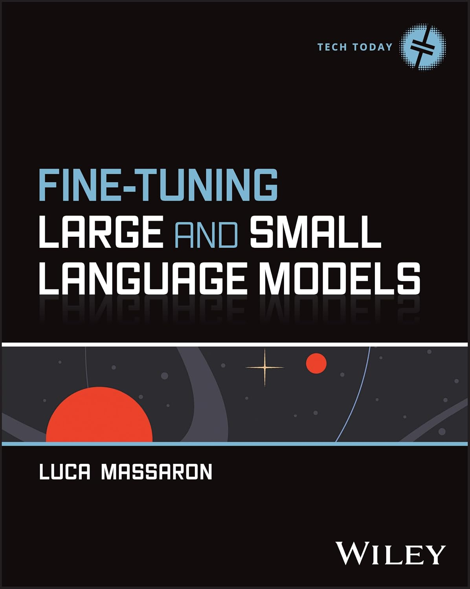

# Fine-Tuning Large and Small Language Models (Tech Today)

<p align="center">
  
</p>

*Fine-Tuning Large and Small Language Models* walks practitioners through the complete pipeline for customizing open-source SLMs for domain-specific tasks. Written by Luca Massaron, a data scientist with 20+ years in data modelling and nearly a decade building NLP solutions with Transformer architectures, the book covers dataset preparation, synthetic data generation, base model selection from families including Gemma, Qwen, Phi, and Llama, and deployment on consumer-grade hardware.

The book frames fine-tuning against alternatives like retrieval-augmented generation and advanced prompting, helping readers determine when fine-tuning is the right approach. Hands-on coverage of parameter-efficient methods, specifically LoRA and QLoRA, shows how to configure Hugging Face PEFT, TRL, and bitsandbytes for training. Evaluation chapters address detecting whether fine-tuning improved target performance without degrading the model's broader capabilities.

Readers will also find:
* Practical case studies covering the end-to-end process from dataset preparation through model evaluation and production deployment
* Guidance on selecting base models from the Gemma, Qwen, Phi, and Llama families for specific use cases
* Techniques for generating synthetic training data where real domain-specific data is scarce or unavailable
* Configuration walkthroughs for Hugging Face PEFT, TRL, and bitsandbytes to run training on consumer hardware
* Final chapters extending fine-tuned SLMs toward autonomous agents and domain-specific production applications

Fine-Tuning Large and Small Language Models serves technical practitioners with programming and machine learning experience who want to move beyond off-the-shelf APIs. Data scientists, ML engineers, and AI developers building customized, cost-effective language models will gain the working knowledge to transform general-purpose SLMs into specialized, production-ready tools.

---

## Repository Structure & Chapters

| Chapter | Topic | GPU Files | macOS (Apple Silicon) Notes |
| :---: | :--- | :--- | :--- |
| **04** | Synthetic Data & Data Augmentation | `listing_4.1-4.10.ipynb`<br>`listing_4.11-4.14.ipynb`<br>`listing_4.15-4.25.ipynb` | Run listings 4.1–4.14 as-is (`BitsAndBytesConfig` 4-bit runs natively on MPS).<br>Use `listing_4.15-4.25_macos.ipynb` for local Ollama serving. |
| **05** | Pre-training & Domain Adaptation | `listing_5.1-5.5.ipynb`<br>`listing_5.6.ipynb`<br>`listing_5.7.ipynb` | Use `listing_5.1-5.5_macos.ipynb` (`torch.mps` memory monitoring), `listing_5.6_macos.ipynb` (standard PEFT), and `listing_5.7_macos.ipynb` (`bfloat16` base model). |
| **06** | Supervised Fine-Tuning (SFT & PEFT) | `listing_6.1-6.9.ipynb`<br>`listing_6.10-6.16.ipynb`<br>`listing_6.17-6.24.ipynb`<br>`listing_6.25-6.29.ipynb`<br>`listing_6.30-6.34.ipynb` | Run listings 6.1–6.9, 6.17–6.24, and 6.30–6.34 as-is on MPS.<br>Use `listing_6.10-6.16_macos.ipynb` and `listing_6.25-6.29_macos.ipynb` (standard PEFT on Metal). |
| **07** | Preference Tuning (DPO & ORPO) | `listing_7.1-7.6.ipynb`<br>`listing_7.7-7.18.ipynb` | Run `listing_7.7-7.18.ipynb` as-is on MPS.<br>Use `listing_7.1-7.6_macos.ipynb` (standard `trl.DPOTrainer` on MPS). |
| **08** | Evaluation & LLM-as-a-Judge | `listing_8.1.ipynb`<br>`listing_8.2.ipynb`<br>`listing_8.3-8.7.ipynb`<br>`listing_8.8.ipynb` | Run listings 8.1, 8.2, and 8.3–8.7 as-is on MPS.<br>Use `listing_8.8_macos.ipynb` (`device="mps"` in `lm-eval`). |
| **09** | Quantization, Serving & Inference | `listing_9.1.ipynb`<br>`listing_9.2.ipynb`<br>`listing_9.2b.ipynb`<br>`listing_9.3.ipynb`<br>`listing_9.3b.ipynb`<br>`listing_9.4.ipynb` – `listing_9.9.ipynb` | Run listings 9.1, 9.2b, 9.3b, 9.7, 9.8, 9.9 as-is.<br>Use `_macos.ipynb` versions for 9.2 (MPS GPTQ), 9.3 (AWQ note), and 9.4–9.6 (native Transformers on MPS). |
| **10** | Multi-Agent Systems & Applications | `train_loras.py`<br>`coding_agent.py` | Use `train_loras_macos.py` and `coding_agent_macos.py` (dynamic tensor routing to MPS and MPS cache clearance). |

---

## How to Use the Code

This codebase is designed to run seamlessly either on **Linux systems equipped with NVIDIA GPUs (CUDA)** or on **Apple Silicon Macs (M-series, using Metal Performance Shaders / MPS)**.

Each chapter uses its own isolated virtual environment managed with [`uv`](https://astral.sh/uv), the ultra-fast Python package and project manager.

### Prerequisites

1. **Install `uv`** (if not already installed):
   ```bash
   curl -LsSf https://astral.sh/uv/install.sh | sh
   source "$HOME/.cargo/env"
   ```

2. **Clone the Repository**:
   ```bash
   git clone https://github.com/lmassaron/finetuning.git
   cd finetuning
   ```

---

### Workflow A: Running on Linux / NVIDIA GPU (CUDA)

1. **Navigate to the target chapter**:
   ```bash
   cd chapter_04  # (or chapter_05, chapter_06, etc.)
   ```

2. **Run the GPU setup script**:
   ```bash
   chmod +x install_ch04.sh
   ./install_ch04.sh
   ```
   *This creates a `.venv_chXX` virtual environment with CUDA-enabled PyTorch, installs GPU dependencies (such as `vllm`, `unsloth`, and `bitsandbytes`), and registers a dedicated Jupyter kernel.*

3. **Activate the environment**:
   ```bash
   source .venv_ch04/bin/activate
   ```

4. **Launch Jupyter Lab / Notebook**:
   ```bash
   jupyter lab
   ```
   *Select the corresponding kernel (e.g. `.venv_ch04`) and execute the standard GPU notebooks (`listing_X.Y.ipynb`) or Python scripts.*

---

### Workflow B: Running on macOS (Apple Silicon MPS)

Apple Silicon Macs use Unified Memory Architecture (UMA) and Metal Performance Shaders (MPS). In modern versions of PyTorch and `bitsandbytes` (0.44+), **4-bit NormalFloat (NF4) quantization and BrainFloat (`bfloat16`) mixed precision run natively on Apple Silicon**.

For CUDA-exclusive libraries (such as `unsloth`, `vllm`, or `autoawq`), dedicated macOS-adapted notebooks (`_macos.ipynb`) and scripts (`_macos.py`) are provided alongside detailed guides in each chapter's `README_macos.md`.

1. **Navigate to the target chapter**:
   ```bash
   cd chapter_04  # (or chapter_05, chapter_06, etc.)
   ```

2. **Run the macOS setup script**:
   ```bash
   chmod +x install_ch04_macos.sh
   ./install_ch04_macos.sh
   ```
   *This builds `.venv_chXX` using macOS ARM64-optimized wheels, configures Apple Metal MPS acceleration, and registers the Jupyter kernel.*

3. **Activate the environment**:
   ```bash
   source .venv_ch04/bin/activate
   ```

4. **Running Notebooks & Scripts**:
   * **Shared Notebooks**: Where a notebook does not have a `_macos` counterpart (e.g. `listing_4.1-4.10.ipynb`, `listing_6.1-6.9.ipynb`, `listing_8.1.ipynb`, `listing_9.1.ipynb`), open the original notebook—it runs natively on macOS.
   * **macOS Adapted Notebooks**: When a `_macos` notebook exists (e.g. `listing_4.15-4.25_macos.ipynb`, `listing_6.10-6.16_macos.ipynb`), open the `_macos` version. Refer to the chapter's `README_macos.md` for specific background and instructions.
   * **Serving with Ollama (Chapters 04 & 09)**: Make sure [Ollama](https://ollama.com/) is installed and running (`ollama serve`) to take advantage of local Metal-accelerated inference.
   * **Chapter 10 Multi-Agent Scripts**: Run the macOS CLI with:
     ```bash
     python coding_agent_macos.py "Your prompt here"
     ```

---

## Authors & Acknowledgments

* **Luca Massaron** — Author
* Published as part of the *Tech Today* series.
